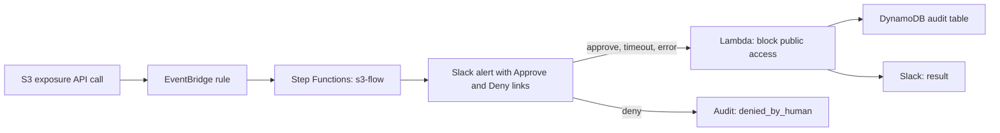
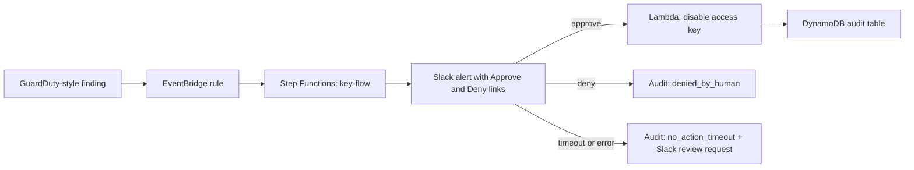

# Cloud SOAR: Automated S3 and IAM Key Remediation


A small security orchestration (SOAR) pipeline that detects risky cloud events,
asks a human for approval in Slack, remediates automatically, and writes an
audit record for every decision. Everything is defined in Terraform and runs
locally on LocalStack, so it costs nothing to try.

## What it does

**Flow 1: public S3 bucket**

1. A bucket is made public (`PutBucketAcl`, `PutBucketPolicy`, or `DeletePublicAccessBlock`).
2. An EventBridge rule starts a Step Functions state machine.
3. Slack gets an alert with **Approve** and **Deny** links.
4. Approve, no response within 45 seconds, or an error in the approval step: a Lambda function makes the bucket private and turns on Block Public Access.
5. Deny: nothing is changed and the decision is recorded.
6. Every outcome is written to a DynamoDB audit table and reported in Slack.

**Flow 2: leaked IAM access key**

1. A GuardDuty-style finding about an IAM user access key arrives.
2. A second state machine asks for approval in Slack (120 second window).
3. Approve: the key is set to `Inactive` (not deleted, so it can be investigated).
4. Deny or no response: **no action is taken**. The key stays active, the event is logged as `no_action_timeout`, and Slack asks for a manual review.

### Why the two flows behave differently on timeout

Closing a public bucket rarely breaks anything, so the bucket flow fails closed
(fix it automatically). Disabling a key can take down a production workload, so
the key flow fails open (a human must decide).

## Architecture





The Approve and Deny links go to a small Lambda function URL. A plain link only
shows a confirmation page, so link previewers and scanners cannot trigger an
action. The action runs only after the confirm button is clicked.

## Repository layout

| Path | Purpose |
|---|---|
| `versions.tf`, `variables.tf`, `outputs.tf` | Providers (pointed at LocalStack), variables, outputs |
| `main.tf` | Test bucket, detection rule, S3 remediation Lambda |
| `audit.tf` | DynamoDB audit table |
| `notify.tf` | Slack notification Lambda |
| `approve.tf` | Approval Lambda and function URL |
| `sfn.tf`, `events.tf` | S3 state machine and EventBridge target |
| `keys.tf`, `sfn_keys.tf` | Access key Lambda, key state machine, GuardDuty-style rule |
| `lambda/` | Python source for all Lambda functions |
| `up.sh`, `down.sh` | Start LocalStack and deploy, or stop it |
| `test_flow.sh`, `test_key_flow.sh` | End-to-end tests |

## Prerequisites

- Docker, Terraform 1.5+, AWS CLI v2
- A free LocalStack account and auth token
- A Slack incoming webhook URL

## Quick start

```bash
export LOCALSTACK_AUTH_TOKEN="..."
read -s "?Slack webhook URL: " SLACKURL; echo   # zsh; in bash use: read -s -p "Slack webhook URL: " SLACKURL
export TF_VAR_slack_webhook_url="$SLACKURL"; unset SLACKURL

./up.sh
./test_flow.sh timeout        # no click needed: auto-fix after 45 seconds
./test_flow.sh approve        # click Approve in Slack
./test_flow.sh deny           # click Deny in Slack
./test_key_flow.sh approve|deny|timeout
./down.sh
```

Never commit the webhook URL or the LocalStack token. Terraform state contains
the webhook URL, which is why `*.tfstate*` is in `.gitignore`.

## Test results

| Test | Expected | Observed |
|---|---|---|
| S3, timeout | Bucket private, audit `success` | Passed in 53.7 s end to end (45 s approval window) |
| S3, approve | Bucket private within seconds | Passed |
| S3, deny | Bucket stays public, audit `denied_by_human` | Passed |
| Key, approve | Key `Inactive`, audit `success` | Passed |
| Key, deny | Key `Active`, audit `denied_by_human` | Passed |
| Key, timeout | Key `Active`, audit `no_action_timeout` | Passed |

## Security scanning

CI runs Checkov as a hard gate. Every finding is either fixed or skipped inline in the
Terraform with a written reason (search for `checkov:skip`). The skips fall into
these groups:

- **Test fixture bucket**: the tests deliberately make it public.
- **Lambda in a VPC and code signing**: no isolation benefit for this workload.
- **Function URL without auth**: Slack links must work without AWS credentials.
- **Customer-managed KMS keys and Secrets Manager**: on the roadmap.
- **Step Functions execution data**: not logged because the state input contains the approval task token.

Known limits of the hardening:

- The dead-letter queue only receives failures from asynchronous invocations. Step Functions invokes the Lambdas synchronously, so today it is defense in depth.
- Reserved concurrency can fail on new AWS accounts with low limits. Set `lambda_reserved_concurrency = -1` there.

## Limitations

- **Simulated detections.** LocalStack does not emulate GuardDuty, AWS Config, or CloudTrail event delivery, so the tests send events with the same shape (source `soar.simulator`). The rules also match the real sources (`aws.s3`, `aws.guardduty`), but this has not been verified on a real AWS account.
- **Approval links are protected only by the secrecy of the Step Functions task token.** The function URL uses no authentication. A production setup should use API Gateway with Slack request signing or SSO.
- **The Slack webhook URL is stored in a Lambda environment variable and in Terraform state.** Use Secrets Manager in a real deployment.
- **Some IAM policies use wildcard resources** (for example `arn:aws:s3:::*`). Tighten them to specific buckets and users.
- **LocalStack's free tier does not persist data across restarts.** `up.sh` recreates everything.
- **LocalStack CORS check.** The confirm step uses a GET link with a no-referrer policy because LocalStack rejects browser POSTs to function URL subdomains.

## Future work

- A real AWS Config rule and GuardDuty integration on a live account
- Slack interactive buttons with signature verification instead of links
- Per-resource allow lists (buckets that are intentionally public)
- Alarms for failed remediations
